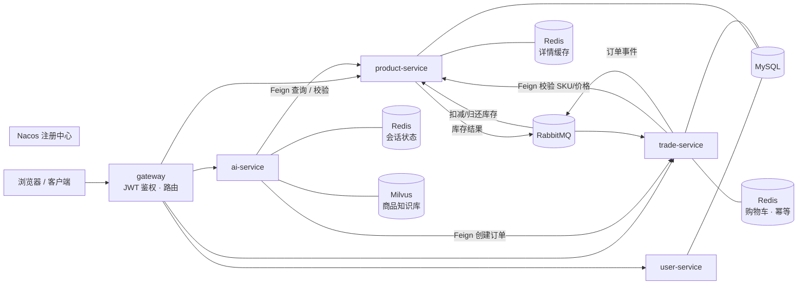

# AI 智能选购商城 (ai-smart-mall)

基于 **Spring Cloud 微服务** 构建的传统电商 + **AI 导购** 综合商城。集成 **Spring AI**，支持自然语言结构化选品、工具调用（Function Calling）与基于 **Milvus** 的 RAG 商品知识问答，并完整实现商品、购物车、订单、库存扣减与异步支付闭环。

## 技术栈

Spring Boot 3.5 · Spring Cloud 2025 (Gateway / OpenFeign / LoadBalancer) · Spring Cloud Alibaba (Nacos) · Spring AI 1.0 · MySQL 8 · Redis · RabbitMQ · Milvus · Docker Compose

## 功能一览

| 模块 | 说明 |
|---|---|
| **gateway** (8080) | Spring Cloud Gateway 统一路由 + JWT 统一鉴权，用户信息通过请求头透传；`/internal/**` 不对外暴露；同时托管演示页面 |
| **user-service** (8081) | 注册 / 登录 (BCrypt + JWT)，启动时自动创建管理员 `admin` |
| **product-service** (8082) | 商品 / SKU 检索，Redis 缓存商品详情（防穿透 + TTL 抖动 + 库存变更主动失效），MQ 消费扣减/归还库存；首次启动生成 **200 款商品 / 约 535 个 SKU** |
| **trade-service** (8083) | Redis 购物车、订单状态机、幂等下单、MQ 库存扣减 + 异步支付 + 超时关单（TTL+死信队列）、补偿任务 |
| **ai-service** (8084) | AI 导购（槽位澄清 / Function Calling / 推荐校验 / 确认下单）与商品知识问答（Milvus RAG） |

## 架构



### 订单与库存：最终一致性

```
下单(trade)  校验 SKU, 以服务端价格计算金额, 落库 status=CREATED
   │  发布 order.created ───────────────► product: 幂等扣减库存 (stock_log + 原子 SQL, 不足则整单回滚)
   │  同时发送延迟消息(TTL=支付时限)               │
   ◄──────────── stock.result ─────────────────────┘
   ├─ 成功: CREATED → PENDING_PAYMENT          失败: CREATED → CANCELLED(库存不足)
   │
   ├─ 支付: 写支付单 → order.pay 事件 → 异步回调: PENDING_PAYMENT → PAID
   │
   └─ 取消 / 超时(延迟队列到期): → CANCELLED, 发布 order.release → product 幂等归还库存
```

- **幂等**：库存扣减以 `order_no` 为主键写 `stock_log`；订单创建用 `Idempotency-Key`（Redis SETNX）；状态流转全部使用 CAS（`UPDATE ... WHERE status IN (...)`）。
- **防超卖**：`UPDATE sku SET stock = stock - ? WHERE id = ? AND stock >= ?`，多 SKU 按 id 排序加锁防死锁。
- **兜底**：`OrderCompensationJob` 会重发长时间卡在 CREATED 的扣库存事件、关闭超时未支付订单（应对消息丢失）；迟到的库存扣减在订单已取消时会自动归还。
- **失败处理**：消费者重试 3 次后丢弃（未配置死信队列，生产环境建议补上）。

### AI 导购：大模型与后端状态机各司其职

```
COLLECTING ──(槽位齐全)──► 推荐 ──► RECOMMENDED ──(选款式/数量)──► CONFIRMING ──(用户确认)──► 创建订单
```

| 步骤 | 谁负责 | 做法 |
|---|---|---|
| 理解用户一句话 | 大模型 | Spring AI 结构化输出 `ChatAnalysis`：意图 + **本轮**新增的预算/品类/用途/配置槽位 |
| 槽位合并、缺失追问 | **后端** | `RequirementSlots.merge` 合并多轮条件；品类与预算必填，用途只追问一次，换品类自动清空旧条件 |
| 检索与推荐 | 大模型 + 工具 | **Function Calling**：`searchProducts` / `getSkuPriceAndStock` / `compareSkus` |
| 推荐结果校验 | **后端** | 模型给的每个 `skuId` 回查商品服务，库存/品类/预算/配置任一不满足即丢弃；全部丢弃则规则兜底 |
| 订单草稿 | **后端** | 价格、库存一律取商品服务实时数据，不信任模型给的任何金额；单次最多 5 件 |
| 确认下单 | **用户 + 后端** | 创建订单**不暴露给模型**；"确认/取消"用正则判定或按钮触发；确认前再次校验价格库存，价格变动会要求重新确认；用 `Idempotency-Key` 防重复 |

### 商品知识问答 (RAG)

- **入库**：PDF (PDFBox) / Markdown / TXT → 标题路径感知 + 表格保护 + 句子级重叠的分块 → 每块带 `modelNo / docName / chunkIndex` 元数据 → 向量化写入 Milvus（按嵌入接口限制分批）。
- **检索**：向量相似度 + **按商品型号元数据过滤**（`modelNo == 当前商品`），不会串到别的商品的说明书。
- **回答**：仅依据检索片段生成，带 `[n]` 引用；没有依据时明确回复"知识库中暂未找到相关信息"。
- **评测**：`eval/run_eval.py` 计算 Hit@K、MRR 与答案关键词准确率。

## 快速开始

### 前置条件

- Docker / Docker Compose
- 一个 OpenAI 兼容的大模型 API Key。默认使用**阿里云百炼（通义千问）**的兼容模式，一个 key 同时提供对话模型（qwen-plus）和向量模型（text-embedding-v3）。
  > DeepSeek 没有向量模型；如果对话想用 DeepSeek，需要另外配置 embedding 服务。
- 本地开发还需要 JDK 17 + Maven 3.9

### 方式一：全部用 Docker 启动

```bash
cp .env.example .env              # 填入 AI_API_KEY
docker compose --profile apps up -d --build
```

首次构建需要下载 Maven 依赖，耗时较长；Nacos、Milvus 启动较慢，应用容器配置了 `restart: on-failure`，等待一两分钟即可。

### 方式二：基础设施用 Docker，微服务在 IDE 里运行

```bash
docker compose up -d              # 只启动 MySQL / Redis / RabbitMQ / Nacos / Milvus
mvn -q -DskipTests package
# 依次运行各模块的 *Application (默认连接 localhost); ai-service 需要设置环境变量 AI_API_KEY
```

### 体验

1. 打开 http://localhost:8080 ，注册并登录；
2. 导入示例商品说明书：`./scripts/load-sample-docs.sh`（使用管理员 admin 上传 `docs/manuals/*.md`，文件名即型号）；
3. 在"AI 导购"里对话，例如：
   - `想买笔记本` → 系统追问预算和用途
   - `预算 5000，主要办公和编程，内存 16G 以上` → 给出推荐
   - `要第一个，买一台` → 生成订单草稿 → 点击"确认下单"
   - `LT-1001 怎么进入 BIOS？` → 知识库问答（附引用片段）
4. 在"购物车与订单"里查看订单：先"库存锁定中"，几秒后变为"待支付"，点击"去支付"后异步变为"已支付"。

> 管理员账号 `admin`，默认密码 `admin123`（见 `.env` 的 `ADMIN_PASSWORD`，请修改）。

## 主要接口 (均经网关 :8080)

| 方法 | 路径 | 说明 |
|---|---|---|
| POST | `/api/users/register` `/api/users/login` | 注册 / 登录（返回 JWT） |
| GET | `/api/products` | 商品检索：`keyword category brand tag minPrice maxPrice minRamGb minStorageGb page size`（无需登录） |
| GET | `/api/products/{id}` | 商品详情（Redis 缓存） |
| GET/POST/PUT/DELETE | `/api/cart` `/api/cart/items` | 购物车；`POST /api/cart/checkout` 结算 |
| POST | `/api/orders` | 创建订单（可带 `Idempotency-Key` 请求头） |
| GET | `/api/orders` `/api/orders/{orderNo}` | 订单列表 / 详情 |
| POST | `/api/orders/{orderNo}/pay` `/cancel` | 异步支付 / 取消 |
| POST | `/api/ai/chat` | AI 导购对话 `{message, conversationId}` |
| POST | `/api/ai/orders/confirm` `/cancel` | 确认 / 取消 AI 生成的订单草稿 |
| POST | `/api/ai/knowledge/documents` | 上传说明书 (multipart: `modelNo`, `file`；仅 admin) |
| GET | `/api/ai/knowledge/search?q=&modelNo=&topK=` | 只检索不生成 |
| POST | `/api/ai/knowledge/ask` | 知识库问答 `{question, modelNo}` |

## 评测与压测

```bash
# 检索与问答评测 (需先 load-sample-docs; 数据集可按自己的文档扩充)
python eval/run_eval.py --user admin --password admin123 --k 5            # Hit@5 / MRR
python eval/run_eval.py --user admin --password admin123 --k 5 --answer  # 同时评测生成答案

# 商品接口并发压测 (统计 QPS / P50 / P95 / P99)
python scripts/bench_products.py --concurrency 40 --requests 2000
```

**请用你自己机器上测得的真实数据**，不要直接引用别人的数字；`--answer` 的准确率是关键词匹配，只是粗略代理指标。

## 单元测试

```bash
mvn test        # JwtUtil / TextChunker / RequirementSlots (无需任何外部服务)
```

## 配置项 (环境变量)

| 变量 | 默认 | 说明 |
|---|---|---|
| `AI_API_KEY` | — | 大模型 API Key |
| `AI_BASE_URL` | 百炼兼容模式 | 任意 OpenAI 兼容服务地址 |
| `AI_CHAT_MODEL` / `AI_EMBEDDING_MODEL` | qwen-plus / text-embedding-v3 | 对话 / 向量模型 |
| `AI_EMBEDDING_DIM` | 1024 | 向量维度，必须与向量模型一致；改维度需删除 Milvus 中已有的集合 |
| `JWT_SECRET` | 开发默认值 | ≥ 32 字节，所有服务必须一致，生产务必修改 |
| `ORDER_TIMEOUT_SECONDS` | 1800 | 支付超时；改动后需先在 RabbitMQ 删除队列 `mall.order.timeout.delay` |
| `SEED_ENABLED` | true | 首次启动是否生成演示商品 |

## 目录结构

```
ai-smart-mall/
├── common/            DTO、MQ 事件与常量、JWT 工具、全局异常
├── gateway/           路由 + JWT 鉴权 + 演示页面 (static/index.html)
├── user-service/      注册登录
├── product-service/   商品/SKU、缓存、库存扣减、演示数据生成
├── trade-service/     购物车、订单、支付、延迟关单、补偿任务
├── ai-service/        AI 导购 (shopping/) 与知识库 RAG (knowledge/)
├── sql/init.sql       三个库的建表脚本
├── docs/manuals/      示例商品说明书 (虚构演示数据)
├── eval/  scripts/    评测、压测、示例文档导入脚本
├── Dockerfile         多阶段构建, 用 MODULE 参数构建任意服务
└── docker-compose.yml 基础设施 + (profile apps) 微服务
```

## 已知限制 / 后续可改进

- **版本兼容**：依赖版本集中在根 `pom.xml`（Spring Boot 3.5.6 / Spring Cloud 2025.0.0 / Spring Cloud Alibaba 2025.0.0.0 / Spring AI 1.0.3）。Spring Cloud Alibaba 与 Spring Boot 的对应关系请以其官方版本说明为准；升级后若 Spring AI 属性名有变化，请对照官方文档调整 `ai-service/src/main/resources/application.yml`。
- **支付是模拟的**：`order.pay` 事件即模拟渠道回调；真实场景需接入支付渠道并做验签、对账、退款。
- **消息可靠性**：生产者未开启 Publisher Confirm / 本地消息表，目前靠补偿任务兜底；消费失败 3 次后丢弃，未配置死信队列。
- **鉴权**：只有 admin / 普通用户两种角色；网关之后的服务默认信任 `X-User-Id` 头，生产环境应限制服务只接受网关来源（网络隔离 / 服务间签名）。
- **扫描版 PDF**：知识库只提取文字层，扫描件需先 OCR。
- **AI 对话为同步返回**，未做流式输出。

## 致谢

整体设计参考了以下开源项目的公开思路：[macrozheng/mall-swarm](https://github.com/macrozheng/mall-swarm)（Spring Cloud 微服务商城）、[pikarchen/da](https://github.com/pikarchen/da)（AI 与业务微服务解耦）、[topikachu/spring-ai-rag](https://github.com/topikachu/spring-ai-rag)（Spring AI + Milvus RAG）、[AzureCosmosDB/multi-agent-spring-ai](https://github.com/AzureCosmosDB/multi-agent-spring-ai)（购物助手工具调用）。本仓库代码为独立实现。

## License

MIT
